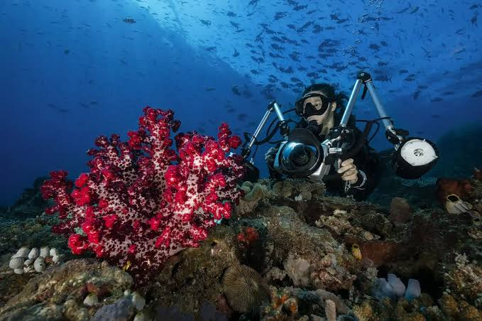
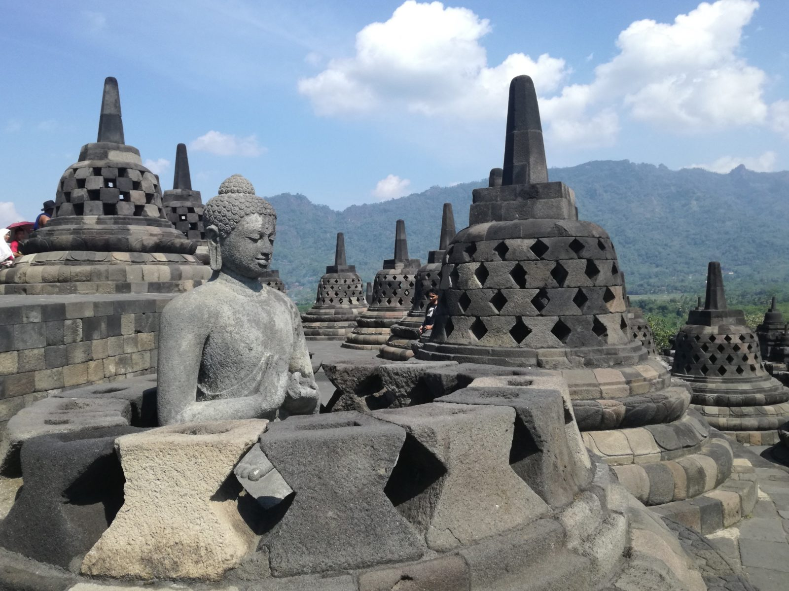

# PRAKTIKUM 4 CSS Lanjutan
<br>
Nama : Irvan Wahyudin <br>
Nim : 312510359
<br><br>


dan berikut adalah [jawaban soal-soal](#Jawab-Pertanyaan-Berikut) dari modul.<br>
Try for html me >>><a href="https://whyyroot.github.io/pemrograman-web/praktikum-4-css-lanjutan/index.html"></a>  
Try for tugas me >>><a href="https://tugas.wahyusite.web.id/praktikum-4-css-lanjutan/project/index.html"/></a> 
<h3>Membuat Struktur HTML</h3>
<table boder="0">
  <tr>
    <td valign="top"><h3>Code</h3>
<details>
<summary><b>📂 Klik untuk melihat Source Code HTML</b></summary>
  
```      
<!DOCTYPE html>
<html lang="en">

<head>
    <meta charset="UTF-8">
    <meta name="viewport" content="width=device-width, initial-scale=1.0">
    <title>Wisata Alam</title>
    <link rel="stylesheet" href="style.css">
</head>

<body>
    <div id="container">
    </div>
</body>

</html>
```

</details>
   </td>
    <td valign="top"><h3>Tampilan</h3>
      
    </td>
  </tr>
</table>


<h3>Menambahkan Menambahkan layout</h3>
<table boder="0">
  <tr>
    <td valign="top"><h3>Code</h3>
<details>
<summary><b>📂 Klik untuk melihat Source Code HTML</b></summary>
      
  ```
<header>
            <h1>WISATA ALAM</h1>
        </header>
        <nav>
            <a href="home.html" class="active">Home</a>
            <a href="artikel.html">Artikel</a>
            <a href="about.html">About</a>
            <a href="kontak.html">Kontak</a>
        </nav>
        <section id="hero"></section>
        <section id="wrapper">
            <section id="main"></section>
            <aside id="sidebar"></aside>
        </section>
        <footer>
            <p>&copy; 2021 - Wisata Alam Indonesia</p>
        </footer>
```
</details>
<details>
<summary><b>📂 Klik untuk melihat Source Code CSS</b></summary>
  
```
/* import google font */
@import url('https://fonts.googleapis.com/css2?family=Open+Sans:ital,wght@0,300;0,400;0,600;0,700;0,800;1,300;1,400;1,600;1,700;1,800&display=swap');
@import url('https://fonts.googleapis.com/css2?family=Open+Sans+Condensed:ital,wght@0,300;0,700;1,300&display=swap');

/* Reset CSS */
* {
    margin: 0;
    padding: 0;
}

body {
    line-height: 1;
    font-size: 100%;
    font-family: 'Open Sans', sans-serif;
    color: #5a5a5a;
}

#container {
    width: 980px;
    margin: 0 auto;
    box-shadow: 0 0 1em #cccccc;
}

/* header */
header {
    padding: 20px;
}

header h1 {
    margin: 20px 10px;
    color: #b5b5b5;
}

/* navigasi */
nav {
    display: block;
    background-color: #1f5faa;
}

nav a {
    padding: 15px 30px;
    display: inline-block;
    color: #ffffff;
    font-size: 14px;
    text-decoration: none;
    font-weight: bold;
}

nav a.active,
nav a:hover {
    background-color: #2b83ea;
}
```
</details>
  </td>
    <td valign="top"><h3>Tampilan</h3>
      
  </td>
  </tr>
</table>

<h3>Menambahkan header bawah</h3>

<table border="0">
  <tr>
    <td valign="top"><h3>Code</h3>
<details>
<summary><b>📂 Klik untuk melihat Source Code HTML</b></summary>
  
Tambahkan di antara ``<section id="hero"> ... </section>``
      
  ```
  <h1>Selamat Datang Di Wisata Alam</h1>
  <p>Temukan keindahan alam nusantara yang tak terjamah, dari pantai tropis yang mempesona hingga pegunungan
    megah yang menantang. Mulai petualangan Anda dan pelajari kekayaan budaya serta keanekaragaman hayati
    Indonesia bersama kami.</p>
  <a href="home.html" class="btn btn-large">Learn more &raquo;</a>
```
</details>
<details>
<summary><b>📂 Klik untuk melihat Source Code CSS</b></summary>
  
```
/* Hero Panel */
#hero {
  background-color: #e4e4e5;
  padding: 50px 20px;
  margin-bottom: 20px;
}
#hero h1 {
  margin-bottom: 20px;
  font-size: 35px;
}
#hero p {
  margin-bottom: 20px;
  font-size: 18px;
  line-height: 25px;
}
```
</details>
  </td>
    <td valign="top"><h3>Tampilan</h3>
      
  </td>
  </tr>
</table>


<h3>Menambahkan Wiget/side bar</h3>

<table boder="0">
  <tr>
    <td valign="top"><h3>Code</h3>
<details>
<summary><b>📂 Klik untuk melihat Source Code HTML</b></summary>
  
Tambahkan di antara ``<section id="hero"> ... </section>``
      
  ```
<div class="widget-box">
  <h3 class="title">Artikel Populer</h3>
   <ul>
     <li><a href="#">Top 10 Pantai Tersembunyi di Indonesia</a></li>
     <li><a href="#">Menjelajahi Taman Nasional Komodo</a></li>
     <li><a href="#">Tips Berwisata Ramah Lingkungan</a></li>
     <li><a href="#">Kuliner Khas Jawa yang Wajib Dicoba</a></li>
     <li><a href="#">Transportasi Antar Pulau di Indonesia</a></li>
   </ul>
</div>
<div class="widget-box">
  <h3 class="title">Berita Terkini</h3>
  <p>Pemerintah Indonesia meluncurkan program Visa Digital Nomad untuk mendukung pekerja jarak jauh
     nternasional yang ingin bekerja sambil menikmati keindahan alam Indonesia. Informasi lebih
     lanjut tersedia di portal imigrasi.</p>
</div>
```
</details>
<details>
<summary><b>📂 Klik untuk melihat Source Code CSS</b></summary>
  
```
/* main content */
#wrapper {
    margin: 0;
}

#main {
    float: left;
    width: 640px;
    padding: 20px;
}

/* sidebar area */
#sidebar {
    float: left;
    width: 260px;
    padding: 20px;
}

/* widget */
.widget-box {
    border: 1px solid #eee;
    margin-bottom: 20px;
}

.widget-box .title {
    padding: 10px 16px;
    background-color: #428bca;
    color: #fff;
}

.widget-box ul {
    list-style-type: none;
}

.widget-box li {
    border-bottom: 1px solid #eee;
}

.widget-box li a {
    padding: 10px 16px;
    color: #333;
    display: block;
    text-decoration: none;
}

.widget-box li:hover a {
    background-color: #eee;
}

.widget-box p {
    padding: 15px;
    line-height: 25px;
}
```
</details>
  </td>
    <td valign="top"><h3>Tampilan</h3>
      
  </td>
  </tr>
</table>

<h3>Menambahkan merapihkan footer</h3>

<table boder="0">
  <tr>
    <td valign="top"><h3>Code</h3>
<details>
<summary><b>📂 Klik untuk melihat Source Code CSS</b></summary>
  
```
/* footer */
footer {
    clear: both;
    background-color: #1d1d1d;
    padding: 20px;
    color: #eee;
}
```
</details>
  </td>
    <td valign="top"><h3>Tampilan</h3>
      
  </td>
  </tr>
</table>

<h3>Menambahkan menambahkan konten awal</h3>

<table boder="0">
  <tr>
    <td valign="top"><h3>Code</h3>
<details>
<summary><b>📂 Klik untuk melihat Source Code HTML</b></summary>
  
Tambahkan di antara ``<section id="main"> ... </section>``
      
  ```
<div class="row">
  <div class="box">
    
    <h3>Surga Bawah Laut</h3>
    <p>Jelajahi terumbu karang warna-warni dan kehidupan laut eksklusif di perairan Raja Ampat dan
      Labuan Bajo. Terumbu karang paling beragam di dunia menanti Anda.</p>
    <a href="#" class="btn btn-default">View detail</a>
  </div>
  <div class="box">
    
    <h3>Petualangan Gunung Berapi</h3>
    <p>Taklukkan puncak-puncak dramatis seperti Bromo dan Rinjani. Nikmati pemandangan matahari
      terbit yang menakjubkan dan kawah yang mengagumkan.</p>
    <a href="#" class="btn btn-default">View detail</a>
  </div>
  <div class="box">
    
    <h3>Warisan Budaya</h3>
    <p>Rasakan kekayaan sejarah dan spiritualitas di Candi Borobudur dan situs warisan UNESCO
      lainnya. Pelajari tradisi lokal yang hidup.
      euismod.</p>
    <a href="#" class="btn btn-default">View detail</a>
  </div>
</div>
```
</details>
<details>
<summary><b>📂 Klik untuk melihat Source Code CSS</b></summary>
  
```
/* box */
.box {
    display: block;
    float: left;
    width: 33.333333%;
    box-sizing: border-box;
    -moz-box-sizing: border-box;
    -webkit-box-sizing: border-box;
    padding: 0 10px;
    text-align: center;
}

.box h3 {
    margin: 15px 0;
}

.box p {
    line-height: 20px;
    font-size: 14px;
    margin-bottom: 15px;
}

.box img {
    width: 110px;
    height: 110px;
    border: 0;
    vertical-align: middle;
    object-fit: cover;
}

.image-circle {
    border-radius: 50%;
}

.row {
    margin: 0 -10px;
    box-sizing: border-box;
    -moz-box-sizing: border-box;
    -webkit-box-sizing: border-box;
}

.row:after,
.row:before,
.entry:after,
.entry:before {
    content: '';
    display: table;
}

.row:after,
.entry:after {
    clear: both;
}
```
</details>
  </td>
    <td valign="top"><h3>Tampilan</h3>
      
  </td>
  </tr>
</table>


<h3>Menambahkan konten lanjutan</h3>

<table boder="0">
  <tr>
    <td valign="top"><h3>Code</h3>
<details>
<summary><b>📂 Klik untuk melihat Source Code HTML</b></summary>
  
Tambahkan di antara ``<section id="main"> ... </section>``,
dibawahnya ``<div class="row"> ... </div>``
      
  ```
<hr class="divider" />
<article class="entry">
  <h2>Destinasi Bulan Ini: Bali</h2>
  
  <p>Bali, Pulau Dewata, menawarkan lebih dari sekadar pantai. Temukan ketenangan di Ubud,
    pelajari tarian tradisional, dan nikmati kuliner lokal. Rasakan harmoni antara manusia,
    alam, dan budaya. Dapatkan panduan wisata lengkap dan penawaran eksklusif untuk perjalanan
  Anda.</p>
</article>
<hr class="divider" />
<article class="entry">
  <h2>Destinasi Impian: Banda Neira</h2>
  
  <p>Banda Neira, kepingan surga di Maluku Tengah, menawarkan perpaduan memukau antara kekayaan
    sejarah dan pesona alam. Jelajahi benteng-benteng kolonial yang megah, nikmati keindahan taman
    laut yang eksotis, dan saksikan kemegahan Gunung Api Banda dari kejauhan. Tempat yang pernah
    menjadi pusat rempah-rempah dunia ini adalah destinasi wajib bagi pecinta wisata bahari dan
    sejarah.</p>
</article>
```
</details>
<details>
<summary><b>📂 Klik untuk melihat Source Code CSS</b></summary>
  
```
.divider {
    border: 0;
    border-top: 1px solid #eeeeee;
    margin: 40px 0;
}

/* entry */

.entry {
    margin: 15px 0;
}

.entry h2 {
    margin-bottom: 20px;
}

.entry p {
    line-height: 25px;
}

.entry img {
    width: 150px;
    height: 150px;
    float: left;
    border-radius: 5px;
    margin-right: 15px;
    object-fit: cover;
}

.entry .right-img {
    float: right;
}   
```
</details>
  </td>
    <td valign="top"><h3>Tampilan</h3>
      
  </td>
  </tr>
</table>

# Jawab Pertanyaan Berikut
1. Tambahkan Layout untuk menu About
=> buat single layout yang berisi deskripsi, portfolio, dll.
<details>
      <summary><b>📂 Code page home</b></summary>
      
```
<!DOCTYPE html>
<html lang="id">

<head>
    <meta charset="UTF-8">
    <meta name="viewport" content="width=device-width, initial-scale=1.0">
    <title>Sahabat Coffee</title>
    <!-- Memanggil file CSS yang sudah ada -->
    <link rel="stylesheet" href="style-kopi.css">
</head>

<body>
    <div id="container">
        <header>
            <h1>SAHABAT COFFEE</h1>
        </header>
        
        <!-- Mulai area Navbar -->
        <nav>
            <a href="index.html" class="active">Home</a>
            <a href="tempat-kopi.html">Tempat Kopi</a>
            <a href="rating.html">Daftar Rating</a>
            <a href="kontak.html">Kontak</a>
        </nav>
        <!-- Akhir area Navbar -->

        <section id="hero">
            <h1>Temukan Kopi Favoritmu</h1>
            <p>Jelajahi berbagai kedai kopi terbaik, dari sudut kota yang tenang hingga kafe modern yang estetik. Temukan ulasan jujur, rating pilihan, dan suasana yang pas untuk menikmati secangkir kopi andalanmu.</p>
            <a href="tempat-kopi.html" class="btn btn-large">Mulai Eksplorasi &raquo;</a>
        </section> 
        
        <section id="wrapper">
            <section id="main">
                <div class="row">
                    <!-- Box Tempat Kopi 1: Douse Path -->
                    <div class="box">
                        
                        <h3>Douse Path</h3>
                        <p><strong>Rating: 4.9 / 5 </strong><br>Arsitektur modern minimalis dengan ruang terbuka. Sangat pas untuk bersantai dengan kopi yang di-roast sempurna.</p>
                        <a href="tempat-kopi.html" class="btn btn-default">Lihat Detail</a>
                    </div>
                    <!-- Box Tempat Kopi 2: Tuan Sua -->
                    <div class="box">
                        
                        <h3>Tuan Sua</h3>
                        <p><strong>Rating: 4.9 / 5 </strong><br>Suasana indie yang menenangkan. Rekomendasi utama untuk membaca buku dengan es kopi susu house blend andalan.</p>
                        <a href="tempat-kopi.html" class="btn btn-default">Lihat Detail</a>
                    </div>
                    <!-- Box Tempat Kopi 3: Desember Coffee -->
                    <div class="box">
                        
                        <h3>Desember Coffee</h3>
                        <p><strong>Rating: 4.8 / 5 </strong><br>Suasana homey dan intim. Pilihan tepat bercengkerama santai ditemani kopi seduh manual yang dibuat penuh ketelitian.</p>
                        <a href="tempat-kopi.html" class="btn btn-default">Lihat Detail</a>
                    </div>
                </div>
                
                <hr class="divider" />
                
                <article class="entry">
                    <h2>Sorotan Bulan Ini: Ciung Coffee</h2>
                    
                    <p>Hadir dengan konsep semi-outdoor yang asri, Ciung Coffee menjadi sorotan bulan ini karena menjadi tempat favorit para pekerja pabrik (anak PT) untuk melepas penat setelah seharian bekerja. Menu andalan kopi susu lokal mereka yang khas dipadukan camilan kekinian sangat pas dinikmati di sore hari.</p>
                </article>
                
                <hr class="divider" />
                
                <article class="entry">
                    <h2>Pilihan WFO & Nugas: Navigasi Coffee</h2>
                    
                    <p>Bagi mahasiswa atau Anda yang bekerja dari kafe (WFO), Navigasi Coffee adalah destinasi yang tepat. Suasana "slow bar"-nya sangat mendukung untuk fokus bekerja atau berdiskusi. Kafe ini menggunakan metode manual brew yang bervariasi, memungkinkan Anda mengeksplorasi cita rasa kopi nusantara sambil menyelesaikan tugas.</p>
                </article>
            </section>
            
            <aside id="sidebar">
                <div class="widget-box">
                    <h3 class="title">Kategori Rating</h3>
                    <ul>
                        <li><a href="#">Top 10 Kopi Susu Terbaik</a></li>
                        <li><a href="#">Kafe Paling Nyaman untuk WFC</a></li>
                        <li><a href="#">Rekomendasi Espresso & Americano</a></li>
                        <li><a href="#">Tempat Ngopi Hidden Gem</a></li>
                    </ul>
                </div>
                <div class="widget-box">
                    <h3 class="title">Info Promo</h3>
                    <p>Jangan lewatkan potongan harga khusus akhir pekan di berbagai kafe favorit. Tunjukkan member Sahabat Coffee Anda untuk mendapatkan diskon hingga 20% pada pembelian minuman kedua.</p>
                </div>
            </aside>
        </section>
        
        <footer>
            <p>&copy; 2026 - Sahabat Coffee</p>
        </footer>
    </div>
</body>

</html>     
```
</details>
<details>
      <summary><b>📂 Code page tempat kopi</b></summary>
      
```
<!DOCTYPE html>
<html lang="id">

<head>
    <meta charset="UTF-8">
    <meta name="viewport" content="width=device-width, initial-scale=1.0">
    <title>Tempat Kopi - Sahabat Coffee</title>
    <link rel="stylesheet" href="style-kopi.css">
</head>

<body>
    <div id="container">
        <header>
            <h1>SAHABAT COFFEE</h1>
        </header>

        <nav>
            <a href="index.html">Home</a>
            <a href="tempat-kopi.html" class="active">Tempat Kopi</a>
            <a href="rating.html">Daftar Rating</a>
            <a href="kontak.html">Kontak</a>
        </nav>

        <section id="wrapper">
            <section id="main">
                <article class="entry">
                    <h2>Tuan Sua Toko Kopi</h2>
                    
                    <p>Menawarkan suasana indie yang menenangkan dengan desain minimalis. Tempat ini sangat
                        direkomendasikan bagi Anda yang mencari ketenangan untuk membaca buku atau menyelesaikan
                        pekerjaan. Menu andalannya adalah es kopi susu dengan racikan house blend yang seimbang antara
                        manis dan pahitnya espresso.</p>
                </article>
                <hr class="divider" />

                <article class="entry">
                    <h2>Navigasi Coffee</h2>
                    
                    <p>Bagi para pencinta kopi single origin, Navigasi Coffee adalah destinasi yang tepat. Kafe ini
                        menggunakan metode manual brew yang bervariasi, memungkinkan Anda mengeksplorasi cita rasa dari
                        berbagai biji kopi nusantara. Suasana kafe cukup hangat dan cocok untuk berdiskusi bersama
                        teman.</p>
                </article>
                <hr class="divider" />
                <article class="entry">
                    <h2>Arabica Coffee</h2>
                    
                    <p>Destinasi premium bagi pencinta kopi sejati. Arabica Coffee menyajikan pilihan biji kopi Arabika
                        berkualitas tinggi dengan metode penyeduhan standar internasional. Desain interiornya yang
                        modern dan minimalis memberikan kesan elegan, menjadikannya tempat yang sempurna untuk menikmati
                        secangkir latte art presisi dan WFC yang produktif.</p>
                </article>
                <hr class="divider" />

                <article class="entry">
                    <h2>Ciung Coffee</h2>
                    
                    <p>Hadir dengan konsep semi-outdoor yang asri dan santai. Ciung Coffee menawarkan suasana yang
                        sangat cocok untuk melepas penat di sore hari sambil mengobrol santai. Menu andalan mereka
                        berfokus pada racikan kopi susu lokal yang khas dipadukan dengan berbagai camilan pendamping
                        yang disajikan secara kekinian.</p>
                </article>
                <hr class="divider" />

                <article class="entry">
                    <h2>Zifa Coffee</h2>
                    
                    <p>Zifa Coffee menonjolkan kenyamanan ekstra dengan area tempat duduk yang luas dan desain estetik.
                        Kombinasi antara pencahayaan ruangan yang hangat dan pilihan menu kopi yang ramah di lambung
                        membuat kafe ini menjadi pilihan favorit untuk menghabiskan waktu berlama-lama bersama sahabat
                        atau sekadar bersantai sendiri.</p>
                </article>
                <hr class="divider" />

                <article class="entry">
                    <h2>Bloo Coffee</h2>
                    
                    <p>Menawarkan nuansa industrial modern dengan sentuhan elemen visual yang ikonik. Bloo Coffee sangat
                        dikenal dengan inovasi minuman racikan mereka, termasuk sajian espresso yang dicampur dengan
                        cita rasa unik yang menyegarkan. Setiap sudut kafenya dirancang sangat fotogenik untuk
                        melengkapi pengalaman visual Anda.</p>
                </article>
                <hr class="divider" />
                <article class="entry">
                    <h2>Douse Path</h2>
                    
                    <p>Douse Path menghadirkan perpaduan arsitektur modern minimalis dengan ruang terbuka yang
                        memanjakan mata. Tempat ini sangat pas untuk bersantai sambil menikmati udara segar dan racikan
                        kopi yang di-roast dengan sempurna. Signature drink mereka wajib dicoba bagi Anda yang menyukai
                        keseimbangan rasa kopi yang halus namun tetap berkarakter.</p>
                </article>
                <hr class="divider" />

                <article class="entry">
                    <h2>Desember Coffee</h2>
                    
                    <p>Sesuai dengan namanya yang memberikan kesan akhir tahun yang sejuk dan hangat, Desember Coffee
                        menawarkan suasana yang sangat *homey* dan intim. Kafe ini adalah pilihan yang tepat untuk
                        bercengkerama santai, ditemani dengan pilihan *pastry* lezat dan sajian kopi seduh manual yang
                        dibuat dengan penuh ketelitian.</p>
                </article>
                <hr class="divider" />

                <article class="entry">
                    <h2>Kopi Nako Sentul</h2>
                    
                    <p>Terkenal dengan bangunan kaca ikoniknya, Kopi Nako cabang Sentul memberikan pengalaman ngopi
                        dengan hembusan angin segar dan pemandangan alam yang asri. Area *outdoor*-nya yang luas sangat
                        cocok untuk nongkrong beramai-ramai di sore hari. Pastikan Anda memesan Es Kopi Nako andalan
                        mereka yang manis, *creamy*, dan menyegarkan.</p>
                </article>
                <hr class="divider" />

                <article class="entry">
                    <h2>Hiiyra Coffee</h2>
                    
                    <p>Hiiyra Coffee memadukan desain interior yang sangat nyaman dengan menu minuman yang inovatif,
                        membuatnya selalu menjadi tempat yang menyenangkan untuk dikunjungi kembali. Jangan lewatkan
                        racikan es kopi susu gula aren andalan mereka yang menggunakan takaran espresso berkualitas
                        tinggi, sangat cocok menemani sesi santai Anda.</p>
                </article>
            </section>

            <aside id="sidebar">
                <div class="widget-box">
                    <h3 class="title">Rekomendasi Editor</h3>
                    <ul>
                        <li><a href="#">Douse path - Coffe Shop Astetic</a></li>
                        <li><a href="#">Kopi tuan sua - Manual Brew Terenak</a></li>
                        <li><a href="#">Zifa Coffee - Pilihan Anak Kampus</a></li>
                        <li><a href="#">Ciung Coffe - Pilihan Anak Pabrik</a></li>
                    </ul>
                </div>
            </aside>

        </section>

        <footer>
            <p>&copy; 2026 - Sahabat Coffee</p>
        </footer>
    </div>
</body>

</html>     
```
</details>
<details>
      <summary><b>📂 Code page rating</b></summary>
      
```
<!DOCTYPE html>
<html lang="id">
<head>
    <meta charset="UTF-8">
    <meta name="viewport" content="width=device-width, initial-scale=1.0">
    <title>Daftar Rating - Sahabat Coffee</title>
    <link rel="stylesheet" href="style-kopi.css">
</head>
<body>
    <div id="container">
        <header>
            <h1>SAHABAT COFFEE</h1>
        </header>
        
        <nav>
            <a href="index.html">Home</a>
            <a href="tempat-kopi.html">Tempat Kopi</a>
            <a href="rating.html" class="active">Daftar Rating</a>
            <a href="kontak.html">Kontak</a>
        </nav>
        
        <section id="wrapper">
            <section id="main">
                <h2 style="margin-bottom: 20px; color: #3e2723;">Peringkat Tertinggi Bulan Ini</h2>
                
                <!-- Baris Pertama: Peringkat 1 - 3 -->
                <div class="row">
                    <div class="box">
                        
                        <h3>1. Douse Path</h3>
                        <p style="font-size: 20px; font-weight: bold; color: #6d4c41;">4.9 / 5</p>
                        <p>Arsitektur modern minimalis. Ruang terbuka yang memanjakan mata dengan kopi yang di-roast sempurna.</p>
                    </div>
                    <div class="box">
                        
                        <h3>2. Tuan Sua</h3>
                        <p style="font-size: 20px; font-weight: bold; color: #6d4c41;">4.9 / 5</p>
                        <p>Suasana indie yang menenangkan. Rekomendasi utama untuk ketenangan dan fokus bekerja.</p>
                    </div>
                    <div class="box">
                        
                        <h3>3. Desember Coffee</h3>
                        <p style="font-size: 20px; font-weight: bold; color: #6d4c41;">4.8 / 5</p>
                        <p>Suasana homey dan intim. Sajian kopi seduh manual yang dibuat dengan penuh ketelitian.</p>
                    </div>
                </div>
                
                <hr class="divider" />
                
                <!-- Baris Kedua: Peringkat 4 - 6 -->
                <div class="row">
                    <div class="box">
                        
                        <h3>4. Bloo Coffee</h3>
                        <p style="font-size: 20px; font-weight: bold; color: #6d4c41;">4.7 / 5</p>
                        <p>Nuansa industrial modern yang ikonik. Sangat fotogenik dengan inovasi sajian espresso racikan.</p>
                    </div>
                    <div class="box">
                        
                        <h3>5. Navigasi Coffee</h3>
                        <p style="font-size: 20px; font-weight: bold; color: #6d4c41;">4.7 / 5</p>
                        <p>Konsep slow bar yang pas untuk WFO. Pilihan manual brew dengan biji kopi nusantara.</p>
                    </div>
                    <div class="box">
                        
                        <h3>6. Ciung Coffee</h3>
                        <p style="font-size: 20px; font-weight: bold; color: #6d4c41;">4.6 / 5</p>
                        <p>Konsep semi-outdoor asri. Favorit untuk melepas penat sepulang kerja di sore hari.</p>
                    </div>
                </div>
            </section>
            
            <aside id="sidebar">
                <div class="widget-box">
                    <h3 class="title">Kriteria Penilaian</h3>
                    <p>Rating diberikan berdasarkan kualitas rasa kopi (40%), suasana dan kenyamanan tempat (30%), pelayanan (20%), serta harga (10%).</p>
                </div>
            </aside>
        </section>
        
        <footer>
            <p>&copy; 2026 - Sahabat Coffee</p>
        </footer>
    </div>
</body>
</html>     
```
</details>
Try for html me >>><a href="https://whyyroot.github.io/pemrograman-web/praktikum-4-css-lanjutan/project/index.html"></a>  

2. Tambahkan layout untuk menu Contact<br>
=> yang berisi form isian: nama, email, message, dll
<details>
      <summary><b>📂 Code page kontak</b></summary>
      
```
<!DOCTYPE html>
<html lang="id">
<head>
    <meta charset="UTF-8">
    <meta name="viewport" content="width=device-width, initial-scale=1.0">
    <title>Kontak - Sahabat Coffee</title>
    <link rel="stylesheet" href="style-kopi.css">
</head>
<body>
    <div id="container">
        <header>
            <h1>SAHABAT COFFEE</h1>
        </header>
        
        <nav>
            <a href="index.html">Home</a>
            <a href="tempat-kopi.html">Tempat Kopi</a>
            <a href="rating.html">Daftar Rating</a>
            <a href="kontak.html" class="active">Kontak</a>
        </nav>
        
        <section id="wrapper">
            <section id="main">
                <h2 style="margin-bottom: 20px; color: #3e2723;">Hubungi Kami</h2>
                <p style="margin-bottom: 20px;">Punya rekomendasi kedai kopi *hidden gem* atau ingin berkolaborasi? Kirimkan pesan Anda melalui formulir di bawah ini.</p>
                
                <form action="#" method="post" style="line-height: 2;">
                    <div style="margin-bottom: 15px;">
                        <label for="nama" style="display: block; font-weight: bold;">Nama Lengkap:</label>
                        <input type="text" id="nama" name="nama" style="width: 100%; padding: 8px; border: 1px solid #d7ccc8; border-radius: 4px;" required>
                    </div>
                    
                    <div style="margin-bottom: 15px;">
                        <label for="email" style="display: block; font-weight: bold;">Email:</label>
                        <input type="email" id="email" name="email" style="width: 100%; padding: 8px; border: 1px solid #d7ccc8; border-radius: 4px;" required>
                    </div>
                    
                    <div style="margin-bottom: 15px;">
                        <label for="pesan" style="display: block; font-weight: bold;">Pesan / Rekomendasi:</label>
                        <textarea id="pesan" name="pesan" rows="5" style="width: 100%; padding: 8px; border: 1px solid #d7ccc8; border-radius: 4px;" required></textarea>
                    </div>
                    
                    <button type="submit" class="btn btn-large" style="border: none; cursor: pointer;">Kirim Pesan</button>
                </form>
            </section>
            
            <aside id="sidebar">
                <div class="widget-box">
                    <h3 class="title">Informasi Kontak</h3>
                    <p><strong>Email:</strong><br> halo@sahabatcoffee.id</p>
                    <p><strong>Sosial Media:</strong><br> @sahabatcoffee_id</p>
                    <p><strong>Alamat:</strong><br> Cikarang, Jawa Barat, Indonesia</p>
                </div>
            </aside>
        </section>
        
        <footer>
            <p>&copy; 2026 - Sahabat Coffee</p>
        </footer>
    </div>
</body>
</html>

```
</details>
Try for html me >>><a href="https://whyyroot.github.io/pemrograman-web/praktikum-4-css-lanjutan/project/kontak.html"></a>  
    
